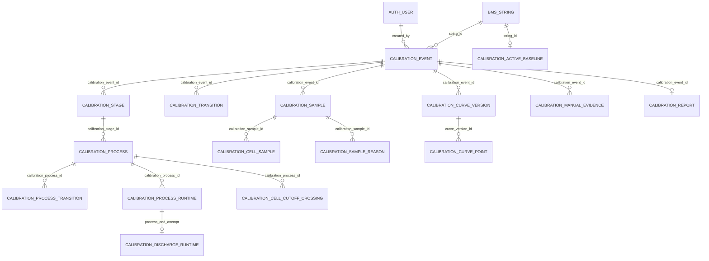

# Cấu trúc PostgreSQL Calibration Event hiện có

Nguồn: catalog PostgreSQL của database `demo` tại `127.0.0.1:5432`, đối chiếu với `FeatureSchemaMigration.java` ngày 2026-09-28. Đây là cấu trúc đã tồn tại trong DB.

## Thiết kế nghiệp vụ cần đạt

- Không tạo event type `PERIODIC_DISCHARGE`. Xả thuộc luồng calibration có xả như `INITIAL_BASELINE`, không phải một event độc lập.
- `MONTHLY_INSPECTION` không có bước xả và không cập nhật SoH. Một lần chạy Monthly chỉ có **một** hàng `calibration_event` với các stage kiểm tra; không sinh process `CONTROLLED_DISCHARGE`.
- Một lần chạy Baseline có **một** hàng `calibration_event`; các bước xả và nạp lại nằm trong `calibration_stage` của cùng event. `CONTROLLED_DISCHARGE` nằm trong `calibration_process` của stage `DISCHARGE` và dùng chung `calibration_event_id` qua các FK tổ hợp.
- `calibration_sample`, `calibration_cell_sample`, `calibration_cell_cutoff_crossing` và `calibration_discharge_runtime` tiếp tục lưu dữ liệu xả theo process/stage của event đó. Không cần thêm bảng `discharge_event` hoặc thay đổi quan hệ giữa 16 bảng để thể hiện yêu cầu này.
- Luồng Monthly hiện tại `PREREQUISITES → MONTHLY_INSPECTION → COMPLETION` phù hợp với việc không có xả; không lấy SoH history từ lần hoàn tất Monthly.
- `SIX_MONTH_INSPECTION` hiện vẫn là event type riêng trong DB/code; yêu cầu này chưa thay đổi luồng đó.

**Chênh lệch hiện tại:** DB và Java vẫn cho phép `PERIODIC_DISCHARGE`, trái với thiết kế nghiệp vụ. Các phần dưới mô tả chính xác schema đang triển khai, không tuyên bố chênh lệch này đã được sửa.

## Phạm vi

- Họ Calibration Event gồm 16 bảng mang tiền tố `bms.calibration_`.
- Sơ đồ bên dưới tập trung vào mô hình Calibration Event; hai bảng được tham chiếu ngoài họ này là `bms.bms_string` và `bms.auth_user`.

## Quan hệ chính

Các FK tổ hợp còn buộc process, sample, evidence và cutoff crossing thuộc **cùng event/stage**; sơ đồ chỉ vẽ cạnh chính để dễ đọc. Hầu hết FK dùng `ON DELETE RESTRICT` nhằm giữ audit trail.

## Vai trò từng bảng

| Nhóm | Bảng | Vai trò |
| --- | --- | --- |
| Gốc | `calibration_event` | Loại, trạng thái, version, cấu hình snapshot, tham chiếu baseline, kết quả cuối |
| Vòng đời | `calibration_stage`, `calibration_transition` | Stage có thứ tự và nhật ký hành động stage/event |
| Process | `calibration_process`, `calibration_process_transition` | Hoạt động tự động trong stage và nhật ký của nó |
| Runtime | `calibration_process_runtime`, `calibration_discharge_runtime` | Checkpoint để tiếp tục worker/discharge sau restart |
| Đo lường | `calibration_sample`, `calibration_cell_sample`, `calibration_sample_reason` | Snapshot string, mỗi cell, lý do lưu mẫu |
| Điểm cắt | `calibration_cell_cutoff_crossing` | Bằng chứng cell chạm ngưỡng trong discharge |
| Đường cong | `calibration_curve_version`, `calibration_curve_point`, `calibration_active_baseline` | Đường cong tham chiếu và baseline đang hoạt động cho string |
| Chứng cứ/báo cáo | `calibration_manual_evidence`, `calibration_report` | Bằng chứng nhập tay và báo cáo đóng event |

## Ràng buộc quan trọng

- `calibration_event_one_open_per_string`: tối đa một event chưa đóng (`closed_at IS NULL`) cho mỗi string.
- `calibration_stage_one_current_per_event`: tối đa một stage ACTIVE/BLOCKED/REVALIDATION_REQUIRED cho mỗi event.
- `calibration_stage` unique `(calibration_event_id, stage_order)`; `calibration_event.current_stage_id` là FK tổ hợp trở về stage của đúng event.
- `event_version` tăng theo thao tác operator được chấp nhận; `measurement_revision` theo cập nhật worker/đo lường.
- `calibration_report` dùng `calibration_event_id` làm PK nên tối đa một báo cáo/event. `calibration_active_baseline` dùng `string_id` làm PK nên tối đa một baseline hoạt động/string.
- Event types **đang được DB chấp nhận**: `INITIAL_BASELINE`, `MONTHLY_INSPECTION`, `SIX_MONTH_INSPECTION`, `PERIODIC_DISCHARGE`. `PERIODIC_DISCHARGE` là chênh lệch với thiết kế nghiệp vụ ở trên. Event status: `DRAFT`, `ACTIVE`, `BLOCKED`, `REVALIDATION_REQUIRED`, `COMPLETED`, `ABORTED`, `CANCELLED`.

## Thứ tự stage đang triển khai theo event type

- `INITIAL_BASELINE`: PREREQUISITES → INITIAL_CHARGE → PRE_DISCHARGE_FLOAT → WAITING_FOR_LOAD → DISCHARGE → LOAD_DISCONNECT → RECHARGE → POST_RECHARGE_FLOAT → BASELINE_CAPTURE → COMPLETION.
- `MONTHLY_INSPECTION`: PREREQUISITES → MONTHLY_INSPECTION → COMPLETION.
- `SIX_MONTH_INSPECTION`: hiện dùng cùng thứ tự stage với `INITIAL_BASELINE`.
- `PERIODIC_DISCHARGE`: PREREQUISITES → PRE_DISCHARGE_FLOAT → WAITING_FOR_LOAD → DISCHARGE → LOAD_DISCONNECT → RECHARGE → POST_RECHARGE_FLOAT → COMPLETION.

`calibration_event` được tạo ở trạng thái DRAFT; khi Start mới tạo/cài đặt stage theo thứ tự cho luồng Monthly. `calibration_transition` và `calibration_process_transition` ghi lịch sử thay đổi; sample/evidence tham chiếu đúng event và stage. Khi hoàn tất stage COMPLETION, event đóng ở COMPLETED, `final_result` và `calibration_report` lưu báo cáo cuối.

## Danh mục cột và ràng buộc đầy đủ

### `bms.calibration_active_baseline`

| Cột | Kiểu | Null | Default |
| --- | --- | --- | --- |
| `string_id` | `uuid` | NOT NULL | `` |
| `curve_version_id` | `bigint` | NOT NULL | `` |
| `calibration_event_id` | `bigint` | NOT NULL | `` |
| `activated_at` | `timestamp with time zone` | NOT NULL | `now()` |

**Constraints:**

- `f`: `FOREIGN KEY (calibration_event_id) REFERENCES bms.calibration_event(id) ON DELETE RESTRICT`
- `f`: `FOREIGN KEY (curve_version_id) REFERENCES bms.calibration_curve_version(id) ON DELETE RESTRICT`
- `f`: `FOREIGN KEY (curve_version_id, string_id, calibration_event_id) REFERENCES bms.calibration_curve_version(id, string_id, calibration_event_id) ON DELETE RESTRICT`
- `f`: `FOREIGN KEY (string_id) REFERENCES bms.bms_string(id) ON DELETE RESTRICT`
- `p`: `PRIMARY KEY (string_id)`
- `u`: `UNIQUE (curve_version_id)`

**Indexes:**

- `calibration_active_baseline_curve_version_id_key`: `CREATE UNIQUE INDEX calibration_active_baseline_curve_version_id_key ON bms.calibration_active_baseline USING btree (curve_version_id)`
- `calibration_active_baseline_pkey`: `CREATE UNIQUE INDEX calibration_active_baseline_pkey ON bms.calibration_active_baseline USING btree (string_id)`

### `bms.calibration_cell_cutoff_crossing`

| Cột | Kiểu | Null | Default |
| --- | --- | --- | --- |
| `id` | `bigint` | NOT NULL | `nextval('bms.calibration_cell_cutoff_crossing_id_seq'::regclass)` |
| `calibration_event_id` | `bigint` | NOT NULL | `` |
| `calibration_stage_id` | `bigint` | NOT NULL | `` |
| `calibration_process_id` | `bigint` | NOT NULL | `` |
| `process_attempt_number` | `integer` | NOT NULL | `` |
| `cell_index` | `integer` | NOT NULL | `` |
| `before_sample_id` | `bigint` | NULL | `` |
| `after_sample_id` | `bigint` | NOT NULL | `` |
| `cutoff_voltage_v` | `numeric` | NOT NULL | `` |
| `crossing_measurement_time` | `timestamp with time zone` | NOT NULL | `` |
| `cell_usable_capacity_ah` | `numeric` | NOT NULL | `` |
| `interpolation_fraction` | `numeric` | NULL | `` |
| `created_at` | `timestamp with time zone` | NOT NULL | `now()` |

**Constraints:**

- `c`: `CHECK ((cell_index > 0))`
- `c`: `CHECK ((cell_usable_capacity_ah >= (0)::numeric))`
- `c`: `CHECK (((interpolation_fraction IS NULL) OR ((interpolation_fraction >= (0)::numeric) AND (interpolation_fraction <= (1)::numeric))))`
- `c`: `CHECK ((process_attempt_number >= 0))`
- `f`: `FOREIGN KEY (after_sample_id, calibration_event_id, calibration_stage_id) REFERENCES bms.calibration_sample(id, calibration_event_id, calibration_stage_id) ON DELETE RESTRICT`
- `f`: `FOREIGN KEY (before_sample_id, calibration_event_id, calibration_stage_id) REFERENCES bms.calibration_sample(id, calibration_event_id, calibration_stage_id) ON DELETE RESTRICT`
- `f`: `FOREIGN KEY (calibration_process_id, calibration_event_id, calibration_stage_id) REFERENCES bms.calibration_process(id, calibration_event_id, calibration_stage_id) ON DELETE RESTRICT`
- `f`: `FOREIGN KEY (after_sample_id) REFERENCES bms.calibration_sample(id) ON DELETE RESTRICT`
- `f`: `FOREIGN KEY (before_sample_id) REFERENCES bms.calibration_sample(id) ON DELETE RESTRICT`
- `f`: `FOREIGN KEY (calibration_event_id) REFERENCES bms.calibration_event(id) ON DELETE RESTRICT`
- `p`: `PRIMARY KEY (id)`
- `u`: `UNIQUE (calibration_process_id, process_attempt_number, cell_index)`

**Indexes:**

- `calibration_cell_cutoff_cross_calibration_process_id_proces_key`: `CREATE UNIQUE INDEX calibration_cell_cutoff_cross_calibration_process_id_proces_key ON bms.calibration_cell_cutoff_crossing USING btree (calibration_process_id, process_attempt_number, cell_index)`
- `calibration_cell_cutoff_crossing_pkey`: `CREATE UNIQUE INDEX calibration_cell_cutoff_crossing_pkey ON bms.calibration_cell_cutoff_crossing USING btree (id)`
- `calibration_cutoff_event_attempt`: `CREATE INDEX calibration_cutoff_event_attempt ON bms.calibration_cell_cutoff_crossing USING btree (calibration_event_id, calibration_process_id, process_attempt_number)`

### `bms.calibration_cell_sample`

| Cột | Kiểu | Null | Default |
| --- | --- | --- | --- |
| `calibration_sample_id` | `bigint` | NOT NULL | `` |
| `cell_index` | `integer` | NOT NULL | `` |
| `voltage_v` | `numeric` | NULL | `` |
| `temperature_c` | `numeric` | NULL | `` |
| `resistance_uohm` | `integer` | NULL | `` |
| `soc_pct` | `numeric` | NULL | `` |
| `soc_method` | `character varying(32)` | NULL | `` |
| `soh_pct` | `numeric` | NULL | `` |
| `soh_method` | `character varying(32)` | NULL | `` |
| `quality` | `character varying(32)` | NOT NULL | `` |
| `availability_warning` | `character varying(64)` | NULL | `` |

**Constraints:**

- `c`: `CHECK ((cell_index > 0))`
- `c`: `CHECK (((resistance_uohm IS NULL) OR (resistance_uohm >= 0)))`
- `c`: `CHECK (((soc_pct IS NULL) OR ((soc_pct >= (0)::numeric) AND (soc_pct <= (100)::numeric))))`
- `c`: `CHECK (((soh_pct IS NULL) OR ((soh_pct >= (0)::numeric) AND (soh_pct <= (100)::numeric))))`
- `f`: `FOREIGN KEY (calibration_sample_id) REFERENCES bms.calibration_sample(id) ON DELETE RESTRICT`
- `p`: `PRIMARY KEY (calibration_sample_id, cell_index)`

**Indexes:**

- `calibration_cell_sample_pkey`: `CREATE UNIQUE INDEX calibration_cell_sample_pkey ON bms.calibration_cell_sample USING btree (calibration_sample_id, cell_index)`

### `bms.calibration_curve_point`

| Cột | Kiểu | Null | Default |
| --- | --- | --- | --- |
| `curve_version_id` | `bigint` | NOT NULL | `` |
| `cell_index` | `integer` | NOT NULL | `` |
| `point_order` | `integer` | NOT NULL | `` |
| `calibration_sample_id` | `bigint` | NOT NULL | `` |
| `milestone_percent` | `numeric` | NOT NULL | `` |
| `normalized_actual_dod_percent` | `numeric` | NOT NULL | `` |
| `discharged_ah` | `numeric` | NOT NULL | `` |
| `cell_voltage_v` | `numeric` | NOT NULL | `` |
| `cell_temperature_c` | `numeric` | NULL | `` |
| `cell_resistance_uohm` | `integer` | NULL | `` |
| `cell_soc_pct` | `numeric` | NULL | `` |
| `cell_soh_pct` | `numeric` | NULL | `` |
| `string_voltage_v` | `numeric` | NULL | `` |
| `average_voltage_v` | `numeric` | NULL | `` |
| `quality` | `character varying(32)` | NOT NULL | `` |
| `usable` | `boolean` | NOT NULL | `` |
| `created_at` | `timestamp with time zone` | NOT NULL | `now()` |

**Constraints:**

- `c`: `CHECK ((cell_index > 0))`
- `c`: `CHECK (((cell_resistance_uohm IS NULL) OR (cell_resistance_uohm >= 0)))`
- `c`: `CHECK (((cell_soc_pct IS NULL) OR ((cell_soc_pct >= (0)::numeric) AND (cell_soc_pct <= (100)::numeric))))`
- `c`: `CHECK (((cell_soh_pct IS NULL) OR ((cell_soh_pct >= (0)::numeric) AND (cell_soh_pct <= (100)::numeric))))`
- `c`: `CHECK ((discharged_ah >= (0)::numeric))`
- `c`: `CHECK ((milestone_percent >= (0)::numeric))`
- `c`: `CHECK ((normalized_actual_dod_percent >= (0)::numeric))`
- `c`: `CHECK ((point_order >= 0))`
- `f`: `FOREIGN KEY (calibration_sample_id) REFERENCES bms.calibration_sample(id) ON DELETE RESTRICT`
- `f`: `FOREIGN KEY (curve_version_id) REFERENCES bms.calibration_curve_version(id) ON DELETE RESTRICT`
- `p`: `PRIMARY KEY (curve_version_id, cell_index, point_order)`
- `u`: `UNIQUE (curve_version_id, cell_index, milestone_percent)`

**Indexes:**

- `calibration_curve_point_curve_version_id_cell_index_milesto_key`: `CREATE UNIQUE INDEX calibration_curve_point_curve_version_id_cell_index_milesto_key ON bms.calibration_curve_point USING btree (curve_version_id, cell_index, milestone_percent)`
- `calibration_curve_point_pkey`: `CREATE UNIQUE INDEX calibration_curve_point_pkey ON bms.calibration_curve_point USING btree (curve_version_id, cell_index, point_order)`
- `calibration_curve_point_sample`: `CREATE INDEX calibration_curve_point_sample ON bms.calibration_curve_point USING btree (calibration_sample_id)`

### `bms.calibration_curve_version`

| Cột | Kiểu | Null | Default |
| --- | --- | --- | --- |
| `id` | `bigint` | NOT NULL | `nextval('bms.calibration_curve_version_id_seq'::regclass)` |
| `calibration_event_id` | `bigint` | NOT NULL | `` |
| `string_id` | `uuid` | NOT NULL | `` |
| `calibration_stage_id` | `bigint` | NOT NULL | `` |
| `calibration_process_id` | `bigint` | NOT NULL | `` |
| `process_attempt_number` | `integer` | NOT NULL | `` |
| `curve_schema_version` | `smallint` | NOT NULL | `1` |
| `capacity_reference_ah` | `numeric` | NOT NULL | `` |
| `string_safe_usable_capacity_ah` | `numeric` | NOT NULL | `` |
| `all_cells_endpoint_ah` | `numeric` | NOT NULL | `` |
| `cell_count` | `integer` | NOT NULL | `` |
| `point_count` | `integer` | NOT NULL | `` |
| `content_hash` | `character varying(128)` | NOT NULL | `` |
| `published_at` | `timestamp with time zone` | NOT NULL | `now()` |

**Constraints:**

- `c`: `CHECK ((all_cells_endpoint_ah >= (0)::numeric))`
- `c`: `CHECK ((capacity_reference_ah > (0)::numeric))`
- `c`: `CHECK ((cell_count > 0))`
- `c`: `CHECK ((string_safe_usable_capacity_ah <= all_cells_endpoint_ah))`
- `c`: `CHECK ((curve_schema_version > 0))`
- `c`: `CHECK ((point_count >= 0))`
- `c`: `CHECK ((process_attempt_number >= 0))`
- `c`: `CHECK ((string_safe_usable_capacity_ah >= (0)::numeric))`
- `f`: `FOREIGN KEY (calibration_event_id) REFERENCES bms.calibration_event(id) ON DELETE RESTRICT`
- `f`: `FOREIGN KEY (calibration_process_id, calibration_event_id, calibration_stage_id) REFERENCES bms.calibration_process(id, calibration_event_id, calibration_stage_id) ON DELETE RESTRICT`
- `f`: `FOREIGN KEY (string_id) REFERENCES bms.bms_string(id) ON DELETE RESTRICT`
- `p`: `PRIMARY KEY (id)`
- `u`: `UNIQUE (calibration_process_id, process_attempt_number)`
- `u`: `UNIQUE (id, string_id, calibration_event_id)`

**Indexes:**

- `calibration_curve_string_published`: `CREATE INDEX calibration_curve_string_published ON bms.calibration_curve_version USING btree (string_id, published_at DESC)`
- `calibration_curve_version_calibration_process_id_process_at_key`: `CREATE UNIQUE INDEX calibration_curve_version_calibration_process_id_process_at_key ON bms.calibration_curve_version USING btree (calibration_process_id, process_attempt_number)`
- `calibration_curve_version_id_string_id_calibration_event_id_key`: `CREATE UNIQUE INDEX calibration_curve_version_id_string_id_calibration_event_id_key ON bms.calibration_curve_version USING btree (id, string_id, calibration_event_id)`
- `calibration_curve_version_pkey`: `CREATE UNIQUE INDEX calibration_curve_version_pkey ON bms.calibration_curve_version USING btree (id)`

### `bms.calibration_discharge_runtime`

| Cột | Kiểu | Null | Default |
| --- | --- | --- | --- |
| `calibration_process_id` | `bigint` | NOT NULL | `` |
| `attempt_number` | `integer` | NOT NULL | `` |
| `last_delta_ah` | `numeric` | NULL | `` |
| `raw_used_ah` | `numeric` | NOT NULL | `0` |
| `official_used_ah` | `numeric` | NOT NULL | `0` |
| `next_dod_milestone_percent` | `integer` | NOT NULL | `5` |
| `per_cell_state` | `jsonb` | NOT NULL | `'{}'::jsonb` |
| `crossed_cell_count` | `integer` | NOT NULL | `0` |
| `configured_cell_count` | `integer` | NULL | `` |
| `string_safe_usable_capacity_ah` | `numeric` | NULL | `` |
| `all_cells_endpoint_ah` | `numeric` | NULL | `` |
| `safety_state` | `character varying(32)` | NOT NULL | `'CLEAR'::character varying` |
| `safety_triggered_at` | `timestamp with time zone` | NULL | `` |
| `frozen_used_ah` | `numeric` | NULL | `` |
| `safety_trigger_cells` | `jsonb` | NOT NULL | `'[]'::jsonb` |
| `created_at` | `timestamp with time zone` | NOT NULL | `now()` |
| `updated_at` | `timestamp with time zone` | NOT NULL | `now()` |

**Constraints:**

- `c`: `CHECK (((string_safe_usable_capacity_ah IS NULL) OR (all_cells_endpoint_ah IS NULL) OR (string_safe_usable_capacity_ah <= all_cells_endpoint_ah)))`
- `c`: `CHECK (((configured_cell_count IS NULL) OR (crossed_cell_count <= configured_cell_count)))`
- `c`: `CHECK (((string_safe_usable_capacity_ah IS NULL) OR (string_safe_usable_capacity_ah >= (0)::numeric)))`
- `c`: `CHECK (((all_cells_endpoint_ah IS NULL) OR (all_cells_endpoint_ah >= (0)::numeric)))`
- `c`: `CHECK ((attempt_number >= 0))`
- `c`: `CHECK (((configured_cell_count IS NULL) OR (configured_cell_count > 0)))`
- `c`: `CHECK ((crossed_cell_count >= 0))`
- `c`: `CHECK (((frozen_used_ah IS NULL) OR (frozen_used_ah >= (0)::numeric)))`
- `c`: `CHECK (((last_delta_ah IS NULL) OR (last_delta_ah >= (0)::numeric)))`
- `c`: `CHECK ((((next_dod_milestone_percent >= 5) AND (next_dod_milestone_percent <= 105)) AND ((next_dod_milestone_percent % 5) = 0)))`
- `c`: `CHECK ((official_used_ah >= (0)::numeric))`
- `c`: `CHECK ((raw_used_ah >= (0)::numeric))`
- `c`: `CHECK (((safety_state)::text = ANY ((ARRAY['CLEAR'::character varying, 'LATCHED'::character varying, 'STOP_CONFIRMED'::character varying])::text[])))`
- `c`: `CHECK ((jsonb_typeof(safety_trigger_cells) = 'array'::text))`
- `f`: `FOREIGN KEY (calibration_process_id, attempt_number) REFERENCES bms.calibration_process_runtime(calibration_process_id, attempt_number) ON DELETE RESTRICT`
- `p`: `PRIMARY KEY (calibration_process_id, attempt_number)`

**Indexes:**

- `calibration_discharge_runtime_pkey`: `CREATE UNIQUE INDEX calibration_discharge_runtime_pkey ON bms.calibration_discharge_runtime USING btree (calibration_process_id, attempt_number)`

### `bms.calibration_event`

| Cột | Kiểu | Null | Default |
| --- | --- | --- | --- |
| `id` | `bigint` | NOT NULL | `nextval('bms.calibration_event_id_seq'::regclass)` |
| `string_id` | `uuid` | NOT NULL | `` |
| `event_type` | `character varying(32)` | NOT NULL | `` |
| `status` | `character varying(32)` | NOT NULL | `'DRAFT'::character varying` |
| `current_stage_id` | `bigint` | NULL | `` |
| `event_version` | `bigint` | NOT NULL | `0` |
| `measurement_revision` | `bigint` | NOT NULL | `0` |
| `record_schema_version` | `smallint` | NOT NULL | `1` |
| `configuration_snapshot` | `jsonb` | NOT NULL | `` |
| `reference_calibration_event_id` | `bigint` | NULL | `` |
| `created_by` | `uuid` | NOT NULL | `` |
| `created_by_name` | `character varying(160)` | NOT NULL | `` |
| `started_at` | `timestamp with time zone` | NULL | `` |
| `completed_at` | `timestamp with time zone` | NULL | `` |
| `closed_at` | `timestamp with time zone` | NULL | `` |
| `restart_revalidation_required` | `boolean` | NOT NULL | `false` |
| `blockers` | `jsonb` | NOT NULL | `'[]'::jsonb` |
| `missing_evidence` | `jsonb` | NOT NULL | `'[]'::jsonb` |
| `final_result` | `jsonb` | NULL | `` |
| `created_at` | `timestamp with time zone` | NOT NULL | `now()` |
| `updated_at` | `timestamp with time zone` | NOT NULL | `now()` |
| `baseline_approved_at` | `timestamp with time zone` | NULL | `` |
| `baseline_approved_by` | `uuid` | NULL | `` |
| `baseline_approved_by_name` | `character varying(160)` | NULL | `` |

**Constraints:**

- `c`: `CHECK ((((baseline_approved_at IS NULL) AND (baseline_approved_by IS NULL) AND (baseline_approved_by_name IS NULL)) OR (((event_type)::text = 'INITIAL_BASELINE'::text) AND ((status)::text = 'COMPLETED'::text) AND (baseline_approved_at IS NOT NULL) AND (baseline_approved_by IS NOT NULL) AND (baseline_approved_by_name IS NOT NULL))))`
- `c`: `CHECK (((((status)::text = 'DRAFT'::text) AND (current_stage_id IS NULL) AND (started_at IS NULL) AND (closed_at IS NULL)) OR (((status)::text = ANY ((ARRAY['ACTIVE'::character varying, 'BLOCKED'::character varying, 'REVALIDATION_REQUIRED'::character varying])::text[])) AND (current_stage_id IS NOT NULL) AND (started_at IS NOT NULL) AND (closed_at IS NULL)) OR (((status)::text = ANY ((ARRAY['COMPLETED'::character varying, 'ABORTED'::character varying, 'CANCELLED'::character varying])::text[])) AND (current_stage_id IS NULL) AND (closed_at IS NOT NULL))))`
- `c`: `CHECK ((record_schema_version > 0))`
- `c`: `CHECK (((status)::text = ANY ((ARRAY['DRAFT'::character varying, 'ACTIVE'::character varying, 'BLOCKED'::character varying, 'REVALIDATION_REQUIRED'::character varying, 'COMPLETED'::character varying, 'ABORTED'::character varying, 'CANCELLED'::character varying])::text[])))`
- `c`: `CHECK ((((started_at IS NULL) OR (completed_at IS NULL) OR (started_at <= completed_at)) AND ((started_at IS NULL) OR (closed_at IS NULL) OR (started_at <= closed_at)) AND ((completed_at IS NULL) OR (closed_at IS NULL) OR (completed_at <= closed_at))))`
- `c`: `CHECK (((event_type)::text = ANY ((ARRAY['INITIAL_BASELINE'::character varying, 'MONTHLY_INSPECTION'::character varying, 'SIX_MONTH_INSPECTION'::character varying, 'PERIODIC_DISCHARGE'::character varying])::text[])))`
- `c`: `CHECK ((event_version >= 0))`
- `c`: `CHECK ((measurement_revision >= 0))`
- `f`: `FOREIGN KEY (baseline_approved_by) REFERENCES bms.auth_user(id) ON DELETE RESTRICT`
- `f`: `FOREIGN KEY (created_by) REFERENCES bms.auth_user(id) ON DELETE RESTRICT`
- `f`: `FOREIGN KEY (current_stage_id, id) REFERENCES bms.calibration_stage(id, calibration_event_id) ON DELETE RESTRICT`
- `f`: `FOREIGN KEY (reference_calibration_event_id) REFERENCES bms.calibration_event(id) ON DELETE RESTRICT`
- `f`: `FOREIGN KEY (string_id) REFERENCES bms.bms_string(id) ON DELETE RESTRICT`
- `p`: `PRIMARY KEY (id)`

**Indexes:**

- `calibration_event_history`: `CREATE INDEX calibration_event_history ON bms.calibration_event USING btree (string_id, created_at DESC)`
- `calibration_event_one_open_per_string`: `CREATE UNIQUE INDEX calibration_event_one_open_per_string ON bms.calibration_event USING btree (string_id) WHERE (closed_at IS NULL)`
- `calibration_event_pkey`: `CREATE UNIQUE INDEX calibration_event_pkey ON bms.calibration_event USING btree (id)`

### `bms.calibration_manual_evidence`

| Cột | Kiểu | Null | Default |
| --- | --- | --- | --- |
| `id` | `bigint` | NOT NULL | `nextval('bms.calibration_manual_evidence_id_seq'::regclass)` |
| `calibration_event_id` | `bigint` | NOT NULL | `` |
| `calibration_stage_id` | `bigint` | NOT NULL | `` |
| `evidence_type` | `character varying(64)` | NOT NULL | `` |
| `status` | `character varying(40)` | NOT NULL | `` |
| `numeric_value` | `numeric` | NULL | `` |
| `text_value` | `text` | NULL | `` |
| `unit` | `character varying(32)` | NULL | `` |
| `instrument_id` | `character varying(128)` | NULL | `` |
| `instrument_resolution` | `numeric` | NULL | `` |
| `instrument_accuracy` | `numeric` | NULL | `` |
| `calibration_reference` | `character varying(256)` | NULL | `` |
| `actor_id` | `uuid` | NOT NULL | `` |
| `actor_name` | `character varying(160)` | NOT NULL | `` |
| `note` | `text` | NULL | `` |
| `external_reference` | `character varying(512)` | NULL | `` |
| `calibration_sample_id` | `bigint` | NULL | `` |
| `recorded_at` | `timestamp with time zone` | NOT NULL | `now()` |

**Constraints:**

- `c`: `CHECK (((status)::text = ANY ((ARRAY['RECORDED'::character varying, 'PASS'::character varying, 'FAIL'::character varying, 'MISSING_NOT_AVAILABLE'::character varying, 'NOT_APPLICABLE'::character varying, 'DATA_INVALID'::character varying])::text[])))`
- `c`: `CHECK (((instrument_accuracy IS NULL) OR (instrument_accuracy >= (0)::numeric)))`
- `c`: `CHECK (((instrument_resolution IS NULL) OR (instrument_resolution >= (0)::numeric)))`
- `f`: `FOREIGN KEY (calibration_sample_id, calibration_event_id, calibration_stage_id) REFERENCES bms.calibration_sample(id, calibration_event_id, calibration_stage_id) ON DELETE RESTRICT`
- `f`: `FOREIGN KEY (actor_id) REFERENCES bms.auth_user(id) ON DELETE RESTRICT`
- `f`: `FOREIGN KEY (calibration_event_id) REFERENCES bms.calibration_event(id) ON DELETE RESTRICT`
- `f`: `FOREIGN KEY (calibration_stage_id, calibration_event_id) REFERENCES bms.calibration_stage(id, calibration_event_id) ON DELETE RESTRICT`
- `p`: `PRIMARY KEY (id)`

**Indexes:**

- `calibration_manual_evidence_event_stage`: `CREATE INDEX calibration_manual_evidence_event_stage ON bms.calibration_manual_evidence USING btree (calibration_event_id, calibration_stage_id, recorded_at)`
- `calibration_manual_evidence_pkey`: `CREATE UNIQUE INDEX calibration_manual_evidence_pkey ON bms.calibration_manual_evidence USING btree (id)`

### `bms.calibration_process`

| Cột | Kiểu | Null | Default |
| --- | --- | --- | --- |
| `id` | `bigint` | NOT NULL | `nextval('bms.calibration_process_id_seq'::regclass)` |
| `calibration_event_id` | `bigint` | NOT NULL | `` |
| `calibration_stage_id` | `bigint` | NOT NULL | `` |
| `process_order` | `integer` | NOT NULL | `` |
| `process_type` | `character varying(64)` | NOT NULL | `` |
| `attempt_number` | `integer` | NOT NULL | `0` |
| `state` | `character varying(32)` | NOT NULL | `'NOT_STARTED'::character varying` |
| `sampling_policy` | `character varying(32)` | NOT NULL | `` |
| `properties` | `jsonb` | NOT NULL | `'{}'::jsonb` |
| `started_at` | `timestamp with time zone` | NULL | `` |
| `completed_at` | `timestamp with time zone` | NULL | `` |
| `started_by` | `uuid` | NULL | `` |
| `completed_by` | `uuid` | NULL | `` |
| `created_at` | `timestamp with time zone` | NOT NULL | `now()` |
| `updated_at` | `timestamp with time zone` | NOT NULL | `now()` |

**Constraints:**

- `c`: `CHECK ((attempt_number >= 0))`
- `c`: `CHECK (((started_at IS NULL) OR (completed_at IS NULL) OR (started_at <= completed_at)))`
- `c`: `CHECK ((process_order >= 0))`
- `c`: `CHECK (((sampling_policy)::text = ANY ((ARRAY['NONE'::character varying, 'FINAL_SNAPSHOT'::character varying, 'PERIODIC'::character varying, 'CONTINUOUS'::character varying])::text[])))`
- `c`: `CHECK (((state)::text = ANY ((ARRAY['NOT_STARTED'::character varying, 'ACTIVE'::character varying, 'BLOCKED'::character varying, 'COMPLETED'::character varying, 'FAILED'::character varying])::text[])))`
- `f`: `FOREIGN KEY (calibration_event_id) REFERENCES bms.calibration_event(id) ON DELETE RESTRICT`
- `f`: `FOREIGN KEY (calibration_stage_id, calibration_event_id) REFERENCES bms.calibration_stage(id, calibration_event_id) ON DELETE RESTRICT`
- `f`: `FOREIGN KEY (completed_by) REFERENCES bms.auth_user(id) ON DELETE RESTRICT`
- `f`: `FOREIGN KEY (started_by) REFERENCES bms.auth_user(id) ON DELETE RESTRICT`
- `p`: `PRIMARY KEY (id)`
- `u`: `UNIQUE (calibration_stage_id, process_order)`
- `u`: `UNIQUE (id, calibration_event_id, calibration_stage_id)`

**Indexes:**

- `calibration_process_active`: `CREATE INDEX calibration_process_active ON bms.calibration_process USING btree (calibration_event_id, calibration_stage_id) WHERE ((state)::text = ANY ((ARRAY['ACTIVE'::character varying, 'BLOCKED'::character varying])::text[]))`
- `calibration_process_calibration_stage_id_process_order_key`: `CREATE UNIQUE INDEX calibration_process_calibration_stage_id_process_order_key ON bms.calibration_process USING btree (calibration_stage_id, process_order)`
- `calibration_process_id_calibration_event_id_calibration_sta_key`: `CREATE UNIQUE INDEX calibration_process_id_calibration_event_id_calibration_sta_key ON bms.calibration_process USING btree (id, calibration_event_id, calibration_stage_id)`
- `calibration_process_pkey`: `CREATE UNIQUE INDEX calibration_process_pkey ON bms.calibration_process USING btree (id)`

### `bms.calibration_process_runtime`

| Cột | Kiểu | Null | Default |
| --- | --- | --- | --- |
| `calibration_process_id` | `bigint` | NOT NULL | `` |
| `attempt_number` | `integer` | NOT NULL | `` |
| `snapshot_generation` | `uuid` | NULL | `` |
| `snapshot_sequence` | `bigint` | NULL | `` |
| `last_captured_at` | `timestamp with time zone` | NULL | `` |
| `last_current_measured_at` | `timestamp with time zone` | NULL | `` |
| `last_domain_current_a` | `numeric` | NULL | `` |
| `last_periodic_persisted_at` | `timestamp with time zone` | NULL | `` |
| `quality_signature` | `character varying(512)` | NULL | `` |
| `checkpoint_data` | `jsonb` | NOT NULL | `'{}'::jsonb` |
| `latest_measurement` | `jsonb` | NOT NULL | `'{}'::jsonb` |
| `blockers` | `jsonb` | NOT NULL | `'[]'::jsonb` |
| `recommendation` | `character varying(32)` | NULL | `` |
| `created_at` | `timestamp with time zone` | NOT NULL | `now()` |
| `updated_at` | `timestamp with time zone` | NOT NULL | `now()` |

**Constraints:**

- `c`: `CHECK ((attempt_number >= 0))`
- `c`: `CHECK (((snapshot_sequence IS NULL) OR (snapshot_sequence >= 0)))`
- `c`: `CHECK ((jsonb_typeof(blockers) = 'array'::text))`
- `c`: `CHECK (((recommendation IS NULL) OR ((recommendation)::text = ANY ((ARRAY['CONTINUE'::character varying, 'BLOCKED'::character varying, 'READY_TO_COMPLETE'::character varying])::text[]))))`
- `f`: `FOREIGN KEY (calibration_process_id) REFERENCES bms.calibration_process(id) ON DELETE RESTRICT`
- `p`: `PRIMARY KEY (calibration_process_id, attempt_number)`

**Indexes:**

- `calibration_process_runtime_pkey`: `CREATE UNIQUE INDEX calibration_process_runtime_pkey ON bms.calibration_process_runtime USING btree (calibration_process_id, attempt_number)`
- `calibration_runtime_updated`: `CREATE INDEX calibration_runtime_updated ON bms.calibration_process_runtime USING btree (updated_at)`

### `bms.calibration_process_transition`

| Cột | Kiểu | Null | Default |
| --- | --- | --- | --- |
| `id` | `bigint` | NOT NULL | `nextval('bms.calibration_process_transition_id_seq'::regclass)` |
| `calibration_event_id` | `bigint` | NOT NULL | `` |
| `calibration_stage_id` | `bigint` | NOT NULL | `` |
| `calibration_process_id` | `bigint` | NOT NULL | `` |
| `from_state` | `character varying(32)` | NULL | `` |
| `to_state` | `character varying(32)` | NOT NULL | `` |
| `action` | `character varying(64)` | NOT NULL | `` |
| `reason` | `character varying(512)` | NULL | `` |
| `actor_id` | `uuid` | NULL | `` |
| `actor_name` | `character varying(160)` | NULL | `` |
| `resulting_event_version` | `bigint` | NOT NULL | `` |
| `occurred_at` | `timestamp with time zone` | NOT NULL | `now()` |
| `evidence` | `jsonb` | NOT NULL | `'{}'::jsonb` |

**Constraints:**

- `c`: `CHECK ((resulting_event_version >= 0))`
- `f`: `FOREIGN KEY (calibration_process_id, calibration_event_id, calibration_stage_id) REFERENCES bms.calibration_process(id, calibration_event_id, calibration_stage_id) ON DELETE RESTRICT`
- `f`: `FOREIGN KEY (actor_id) REFERENCES bms.auth_user(id) ON DELETE RESTRICT`
- `p`: `PRIMARY KEY (id)`

**Indexes:**

- `calibration_process_transition_history`: `CREATE INDEX calibration_process_transition_history ON bms.calibration_process_transition USING btree (calibration_event_id, calibration_stage_id, occurred_at)`
- `calibration_process_transition_pkey`: `CREATE UNIQUE INDEX calibration_process_transition_pkey ON bms.calibration_process_transition USING btree (id)`

### `bms.calibration_report`

| Cột | Kiểu | Null | Default |
| --- | --- | --- | --- |
| `calibration_event_id` | `bigint` | NOT NULL | `` |
| `report_schema_version` | `smallint` | NOT NULL | `` |
| `report_data` | `jsonb` | NOT NULL | `` |
| `generated_at` | `timestamp with time zone` | NOT NULL | `now()` |
| `generated_by` | `uuid` | NOT NULL | `` |
| `content_hash` | `character varying(128)` | NOT NULL | `` |

**Constraints:**

- `c`: `CHECK ((report_schema_version > 0))`
- `f`: `FOREIGN KEY (calibration_event_id) REFERENCES bms.calibration_event(id) ON DELETE RESTRICT`
- `f`: `FOREIGN KEY (generated_by) REFERENCES bms.auth_user(id) ON DELETE RESTRICT`
- `p`: `PRIMARY KEY (calibration_event_id)`

**Indexes:**

- `calibration_report_pkey`: `CREATE UNIQUE INDEX calibration_report_pkey ON bms.calibration_report USING btree (calibration_event_id)`

### `bms.calibration_sample`

| Cột | Kiểu | Null | Default |
| --- | --- | --- | --- |
| `id` | `bigint` | NOT NULL | `nextval('bms.calibration_sample_id_seq'::regclass)` |
| `calibration_event_id` | `bigint` | NOT NULL | `` |
| `calibration_stage_id` | `bigint` | NOT NULL | `` |
| `calibration_process_id` | `bigint` | NULL | `` |
| `process_attempt_number` | `integer` | NULL | `` |
| `snapshot_generation` | `uuid` | NOT NULL | `` |
| `snapshot_sequence` | `bigint` | NOT NULL | `` |
| `measurement_time` | `timestamp with time zone` | NOT NULL | `` |
| `persistence_reason` | `character varying(48)` | NOT NULL | `` |
| `quality` | `character varying(32)` | NOT NULL | `` |
| `blocker_reason` | `character varying(64)` | NULL | `` |
| `raw_current_a` | `numeric` | NULL | `` |
| `domain_current_a` | `numeric` | NULL | `` |
| `current_direction` | `character varying(16)` | NULL | `` |
| `mapping_version` | `bigint` | NULL | `` |
| `current_measured_at` | `timestamp with time zone` | NULL | `` |
| `current_quality` | `character varying(32)` | NULL | `` |
| `string_voltage_v` | `numeric` | NULL | `` |
| `midpoint_voltage_v` | `numeric` | NULL | `` |
| `average_voltage_v` | `numeric` | NULL | `` |
| `ambient_temperature_c` | `numeric` | NULL | `` |
| `average_cell_temperature_c` | `numeric` | NULL | `` |
| `delta_seconds` | `numeric` | NULL | `` |
| `delta_ah` | `numeric` | NULL | `` |
| `raw_used_ah` | `numeric` | NULL | `` |
| `representative_discharge_temperature_c` | `numeric` | NULL | `` |
| `temperature_factor_kc` | `numeric` | NULL | `` |
| `corrected_used_ah` | `numeric` | NULL | `` |
| `soc_pct` | `numeric` | NULL | `` |
| `soc_method` | `character varying(32)` | NULL | `` |
| `dod_pct` | `numeric` | NULL | `` |
| `float_target_voltage_v` | `numeric` | NULL | `` |
| `boost_target_voltage_v` | `numeric` | NULL | `` |
| `created_at` | `timestamp with time zone` | NOT NULL | `now()` |

**Constraints:**

- `c`: `CHECK (((corrected_used_ah IS NULL) OR (corrected_used_ah >= (0)::numeric)))`
- `c`: `CHECK (((current_direction IS NULL) OR ((current_direction)::text = ANY ((ARRAY['POSITIVE'::character varying, 'NEGATIVE'::character varying])::text[]))))`
- `c`: `CHECK (((delta_ah IS NULL) OR (delta_ah >= (0)::numeric)))`
- `c`: `CHECK (((delta_seconds IS NULL) OR (delta_seconds >= (0)::numeric)))`
- `c`: `CHECK (((dod_pct IS NULL) OR (dod_pct >= (0)::numeric)))`
- `c`: `CHECK (((mapping_version IS NULL) OR (mapping_version >= 0)))`
- `c`: `CHECK (((process_attempt_number IS NULL) OR (process_attempt_number >= 0)))`
- `c`: `CHECK (((quality)::text = ANY ((ARRAY['VALID'::character varying, 'INVALID'::character varying, 'STALE'::character varying, 'PARTIAL'::character varying, 'CONFIGURATION_MISMATCH'::character varying, 'CURRENT_UNAVAILABLE'::character varying, 'CELL_DATA_INCOMPLETE'::character varying, 'LEGACY_UNKNOWN'::character varying])::text[])))`
- `c`: `CHECK (((raw_used_ah IS NULL) OR (raw_used_ah >= (0)::numeric)))`
- `c`: `CHECK (((persistence_reason)::text = ANY ((ARRAY['PERIODIC_SAMPLE'::character varying, 'FINAL_SNAPSHOT'::character varying, 'QUALITY_CHANGE'::character varying, 'CURRENT_PEAK'::character varying, 'DOD_MILESTONE_5_PERCENT'::character varying, 'TARGET_DOD'::character varying, 'CUTOFF'::character varying, 'SAFETY_FLOOR'::character varying])::text[])))`
- `c`: `CHECK ((snapshot_sequence >= 0))`
- `c`: `CHECK (((soc_pct IS NULL) OR ((soc_pct >= (0)::numeric) AND (soc_pct <= (100)::numeric))))`
- `c`: `CHECK (((temperature_factor_kc IS NULL) OR (temperature_factor_kc > (0)::numeric)))`
- `f`: `FOREIGN KEY (calibration_event_id) REFERENCES bms.calibration_event(id) ON DELETE RESTRICT`
- `f`: `FOREIGN KEY (calibration_stage_id, calibration_event_id) REFERENCES bms.calibration_stage(id, calibration_event_id) ON DELETE RESTRICT`
- `f`: `FOREIGN KEY (calibration_process_id, calibration_event_id, calibration_stage_id) REFERENCES bms.calibration_process(id, calibration_event_id, calibration_stage_id) ON DELETE RESTRICT`
- `p`: `PRIMARY KEY (id)`
- `u`: `UNIQUE (calibration_event_id, snapshot_generation, snapshot_sequence)`
- `u`: `UNIQUE (id, calibration_event_id, calibration_stage_id)`

**Indexes:**

- `calibration_sample_calibration_event_id_snapshot_generation_key`: `CREATE UNIQUE INDEX calibration_sample_calibration_event_id_snapshot_generation_key ON bms.calibration_sample USING btree (calibration_event_id, snapshot_generation, snapshot_sequence)`
- `calibration_sample_event_stage_identity`: `CREATE UNIQUE INDEX calibration_sample_event_stage_identity ON bms.calibration_sample USING btree (id, calibration_event_id, calibration_stage_id)`
- `calibration_sample_event_stage_time`: `CREATE INDEX calibration_sample_event_stage_time ON bms.calibration_sample USING btree (calibration_event_id, calibration_stage_id, measurement_time)`
- `calibration_sample_pkey`: `CREATE UNIQUE INDEX calibration_sample_pkey ON bms.calibration_sample USING btree (id)`

### `bms.calibration_sample_reason`

| Cột | Kiểu | Null | Default |
| --- | --- | --- | --- |
| `calibration_sample_id` | `bigint` | NOT NULL | `` |
| `persistence_reason` | `character varying(48)` | NOT NULL | `` |
| `reason_key` | `character varying(96)` | NOT NULL | `''::character varying` |
| `milestone_value` | `numeric` | NULL | `` |
| `created_at` | `timestamp with time zone` | NOT NULL | `now()` |

**Constraints:**

- `c`: `CHECK (((persistence_reason)::text = ANY ((ARRAY['PERIODIC_SAMPLE'::character varying, 'FINAL_SNAPSHOT'::character varying, 'QUALITY_CHANGE'::character varying, 'CURRENT_PEAK'::character varying, 'DOD_MILESTONE_5_PERCENT'::character varying, 'TARGET_DOD'::character varying, 'CUTOFF'::character varying, 'SAFETY_FLOOR'::character varying])::text[])))`
- `f`: `FOREIGN KEY (calibration_sample_id) REFERENCES bms.calibration_sample(id) ON DELETE RESTRICT`
- `p`: `PRIMARY KEY (calibration_sample_id, persistence_reason, reason_key)`

**Indexes:**

- `calibration_sample_reason_pkey`: `CREATE UNIQUE INDEX calibration_sample_reason_pkey ON bms.calibration_sample_reason USING btree (calibration_sample_id, persistence_reason, reason_key)`

### `bms.calibration_stage`

| Cột | Kiểu | Null | Default |
| --- | --- | --- | --- |
| `id` | `bigint` | NOT NULL | `nextval('bms.calibration_stage_id_seq'::regclass)` |
| `calibration_event_id` | `bigint` | NOT NULL | `` |
| `stage_order` | `integer` | NOT NULL | `` |
| `stage_type` | `character varying(48)` | NOT NULL | `` |
| `state` | `character varying(32)` | NOT NULL | `'NOT_STARTED'::character varying` |
| `property_schema_version` | `smallint` | NOT NULL | `1` |
| `properties` | `jsonb` | NOT NULL | `'{}'::jsonb` |
| `result` | `character varying(32)` | NULL | `` |
| `blocker_code` | `character varying(64)` | NULL | `` |
| `blocker_detail` | `jsonb` | NULL | `` |
| `started_at` | `timestamp with time zone` | NULL | `` |
| `completed_at` | `timestamp with time zone` | NULL | `` |
| `started_by` | `uuid` | NULL | `` |
| `completed_by` | `uuid` | NULL | `` |
| `created_at` | `timestamp with time zone` | NOT NULL | `now()` |
| `updated_at` | `timestamp with time zone` | NOT NULL | `now()` |

**Constraints:**

- `c`: `CHECK (((started_at IS NULL) OR (completed_at IS NULL) OR (started_at <= completed_at)))`
- `c`: `CHECK ((property_schema_version > 0))`
- `c`: `CHECK (((result IS NULL) OR ((result)::text = ANY ((ARRAY['PASS'::character varying, 'FAIL'::character varying, 'COMPLETED_WITH_GAPS'::character varying, 'NOT_APPLICABLE'::character varying])::text[]))))`
- `c`: `CHECK ((stage_order >= 0))`
- `c`: `CHECK (((state)::text = ANY ((ARRAY['NOT_STARTED'::character varying, 'READY'::character varying, 'ACTIVE'::character varying, 'BLOCKED'::character varying, 'REVALIDATION_REQUIRED'::character varying, 'COMPLETED'::character varying, 'SKIPPED'::character varying, 'FAILED'::character varying])::text[])))`
- `c`: `CHECK (((stage_type)::text = ANY ((ARRAY['PREREQUISITES'::character varying, 'INITIAL_CHARGE'::character varying, 'PRE_DISCHARGE_FLOAT'::character varying, 'WAITING_FOR_LOAD'::character varying, 'DISCHARGE'::character varying, 'LOAD_DISCONNECT'::character varying, 'RECHARGE'::character varying, 'POST_RECHARGE_FLOAT'::character varying, 'BASELINE_CAPTURE'::character varying, 'MONTHLY_INSPECTION'::character varying, 'SIX_MONTH_INSPECTION'::character varying, 'COMPLETION'::character varying])::text[])))`
- `f`: `FOREIGN KEY (calibration_event_id) REFERENCES bms.calibration_event(id) ON DELETE RESTRICT`
- `f`: `FOREIGN KEY (completed_by) REFERENCES bms.auth_user(id) ON DELETE RESTRICT`
- `f`: `FOREIGN KEY (started_by) REFERENCES bms.auth_user(id) ON DELETE RESTRICT`
- `p`: `PRIMARY KEY (id)`
- `u`: `UNIQUE (calibration_event_id, stage_order)`
- `u`: `UNIQUE (id, calibration_event_id)`

**Indexes:**

- `calibration_stage_calibration_event_id_stage_order_key`: `CREATE UNIQUE INDEX calibration_stage_calibration_event_id_stage_order_key ON bms.calibration_stage USING btree (calibration_event_id, stage_order)`
- `calibration_stage_id_calibration_event_id_key`: `CREATE UNIQUE INDEX calibration_stage_id_calibration_event_id_key ON bms.calibration_stage USING btree (id, calibration_event_id)`
- `calibration_stage_one_current_per_event`: `CREATE UNIQUE INDEX calibration_stage_one_current_per_event ON bms.calibration_stage USING btree (calibration_event_id) WHERE ((state)::text = ANY ((ARRAY['ACTIVE'::character varying, 'BLOCKED'::character varying, 'REVALIDATION_REQUIRED'::character varying])::text[]))`
- `calibration_stage_pkey`: `CREATE UNIQUE INDEX calibration_stage_pkey ON bms.calibration_stage USING btree (id)`

### `bms.calibration_transition`

| Cột | Kiểu | Null | Default |
| --- | --- | --- | --- |
| `id` | `bigint` | NOT NULL | `nextval('bms.calibration_transition_id_seq'::regclass)` |
| `calibration_event_id` | `bigint` | NOT NULL | `` |
| `calibration_stage_id` | `bigint` | NOT NULL | `` |
| `from_state` | `character varying(32)` | NULL | `` |
| `to_state` | `character varying(32)` | NOT NULL | `` |
| `action` | `character varying(64)` | NOT NULL | `` |
| `reason` | `character varying(512)` | NULL | `` |
| `actor_id` | `uuid` | NULL | `` |
| `actor_name` | `character varying(160)` | NULL | `` |
| `evidence` | `jsonb` | NOT NULL | `'{}'::jsonb` |
| `resulting_event_version` | `bigint` | NOT NULL | `` |
| `transition_order` | `smallint` | NOT NULL | `0` |
| `occurred_at` | `timestamp with time zone` | NOT NULL | `now()` |

**Constraints:**

- `c`: `CHECK ((resulting_event_version >= 0))`
- `c`: `CHECK ((transition_order >= 0))`
- `f`: `FOREIGN KEY (actor_id) REFERENCES bms.auth_user(id) ON DELETE RESTRICT`
- `f`: `FOREIGN KEY (calibration_event_id) REFERENCES bms.calibration_event(id) ON DELETE RESTRICT`
- `f`: `FOREIGN KEY (calibration_stage_id, calibration_event_id) REFERENCES bms.calibration_stage(id, calibration_event_id) ON DELETE RESTRICT`
- `p`: `PRIMARY KEY (id)`
- `u`: `UNIQUE (calibration_event_id, resulting_event_version, transition_order)`

**Indexes:**

- `calibration_transition_calibration_event_id_resulting_event_key`: `CREATE UNIQUE INDEX calibration_transition_calibration_event_id_resulting_event_key ON bms.calibration_transition USING btree (calibration_event_id, resulting_event_version, transition_order)`
- `calibration_transition_pkey`: `CREATE UNIQUE INDEX calibration_transition_pkey ON bms.calibration_transition USING btree (id)`

## Nguồn code

- `Integrate-MaxiEMS/apps/bms/services/io.openems.edge.bms.service/src/io/openems/edge/bms/service/persistence/implement/FeatureSchemaMigration.java`
- `Integrate-MaxiEMS/apps/bms/services/io.openems.edge.bms.service/src/io/openems/edge/bms/service/calibration/implement/CalibrationProcessDefinition.java`
- `.trellis/spec/backend/bms-calibration-events.md`
